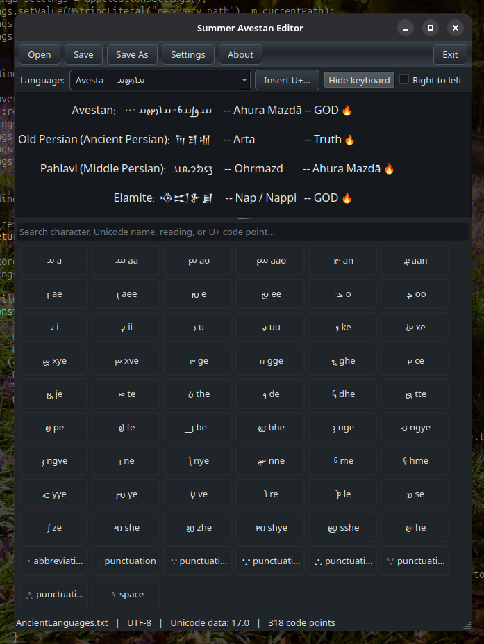

# Avestan Editor

[فارسی](README.fa.md)

Avestan Editor is a cross-platform Unicode text editor for ancient scripts and
other writing systems, built with Qt Widgets. Its software keyboard starts with
Avesta, Pahlavi, Parthian, and Ancient Persian, followed by other historic
scripts, other Unicode scripts, general symbols, and an **All printable
Unicode** keyboard.

The editor runs on Linux, Windows, and Android. You can open, edit, and save
Unicode text documents in UTF-8 (with or without BOM), UTF-16 LE/BE, or BOM-marked
UTF-32 LE/BE. Invalid UTF data is rejected instead of silently replaced. All
settings, language data, readings, Unicode character names, and user-visible
strings are embedded from the `assets/` directory through Qt resources.



Summer Avestan Editor V 1.0 on Linux Desktop

## Run and build

Requires a Qt 6 development environment with Qt Widgets and Qt Test (`qmake6`).
On Debian/Ubuntu install `qt6-base-dev` and `qt6-base-dev-tools`.

The `Makefile` builds native and cross-platform targets. Output files are named
`<AppName>-<OS>-<arch>`, for example `SummerAvestanEditor-Linux-amd64`,
`SummerAvestanEditor-Termux-arm64`, `SummerAvestanEditor-Windows-amd64.exe`, and
`SummerAvestanEditor-Android-arm64.apk`.

```sh
make                 # native build (Linux on a desktop, Termux in Termux)
make linux           # desktop Linux binary
make termux          # Termux (Android/bionic) binary
make windows         # Windows .exe
make android         # Android .apk
make test            # Qt Test regression suite
make run             # run the native build
make clean           # remove dist/ and test builds
```

Architecture-specific targets are `linux-amd64 linux-arm64 linux-386`,
`termux-arm64 termux-arm arm termux-amd64`, `windows-amd64 windows-arm64
windows-386`, and `android-arm64 android-arm android-amd64`. Cross builds need a
Qt kit built for the target, so point the relevant variable at that kit's qmake.
The Windows qmake project embeds `img/Icon.ico` as the executable icon. Regenerate it
from `img/Icon.png` with `python3 scripts/create-windows-icon.py` (requires libpng):

```sh
python3 scripts/create-windows-icon.py
make windows WINDOWS_QMAKE=/opt/Qt/6.8.0/mingw_64/bin/qmake
make android ANDROID_QMAKE=$HOME/Qt/6.8.0/android_arm64_v8a/bin/qmake \
             ANDROID_NDK_ROOT=$HOME/Android/Sdk/ndk/27.0.12077973
```

The single-file qmake build is still available as `qmake6 AvestanEditor.pro &&
make` (or `make build`), and `bash tests/run-tests.sh` runs the tests. A CMake
project file is also provided for portability. Some Termux Qt packages ship
incomplete Qt plugin CMake metadata (a dangling GTK3 platform-theme target),
which makes `find_package(Qt6)` fail before compilation; the qmake project is
the canonical, working build path. Android packaging follows the usual Qt for
Android workflow (`androiddeployqt` with the Android SDK/NDK).

## Desktop and portable Linux builds

After `make linux-amd64`, install a per-user desktop launcher with
`./scripts/install-desktop-launcher.sh`. It copies the executable into
`~/.local/opt` and installs the icon and `.desktop` entry. The target machine
still needs compatible Qt 6 runtime libraries. To create a bundled AppImage,
run `./scripts/package-portable-appimage.sh`; it downloads linuxdeploy and its Qt
plugin and bundles the runtime. Review downloaded tools and dependencies before
using them on production systems.

## Please Donate!

We truly appreciate and thank you for any donation you can give to our project.


Ethereum `0x6E6465394D14975956cd1BD37ab4E35F2C60300E`

Copyright&copy; 2026 [ArdeshirV](mailto:ArdeshirV@protonmail.com), Licensed under GPL<sup>v3+</sup>
